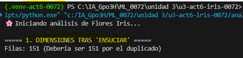
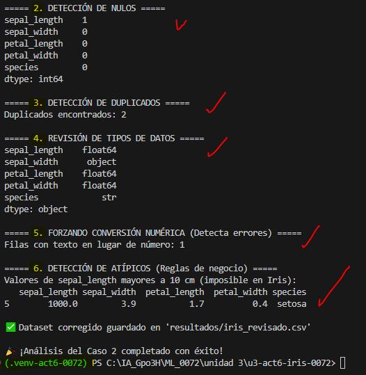
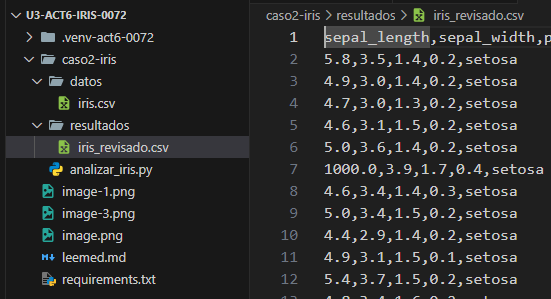

# 🌸 4. Caso 2: Identificación de problemas (Flores Iris)

## DIMENSIONES TRAS 'ENSUCIAR'

## DETECCIÓN DE DUPLICADOS, REVISIÓN DE TIPOS DE DATOS, FORZANDO CONVERSIÓN NUMÉRICA (Detecta errores), DETECCIÓN DE ATÍPICOS (Reglas de negocio).

## estructura de archivos 
